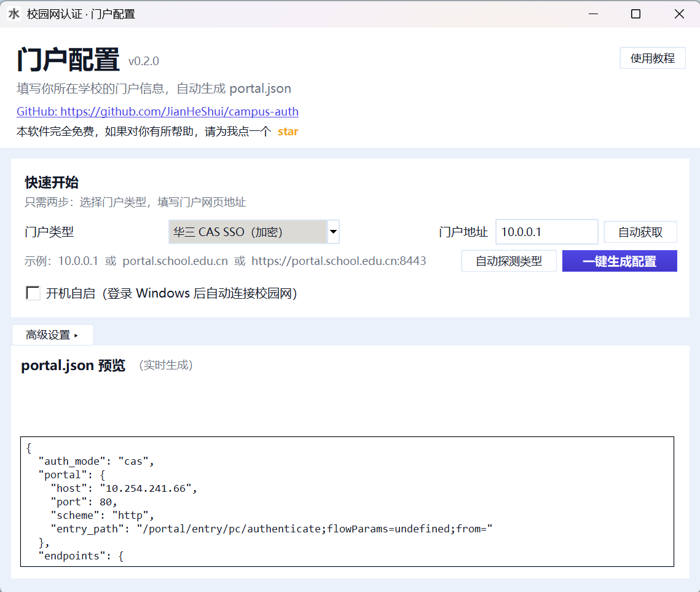

# 校园网自动登录工具

一个 Windows 校园网自动认证工具：**配置一次，后台守护、断线自动重连**，无需每次手动打开认证页。

- 🚀 接口直连，不驱动浏览器，快、稳、省资源
- 🖥️ 可视化中文配置界面，任何学校的门户都能填
- 📌 系统托盘常驻，一键开关
- 🔁 断线自动重连，失败自动退避重试
- 🎛️ **三种认证模式**：锐捷 SAM+ 工作流 / 华三 CAS SSO / 通用登录
- 🔍 门户类型自动探测，断网自动获取地址

---

## 下载与安装

1. 到 [Releases](https://github.com/JianHeShui/campus-auth/releases) 页面，下载最新版 **`campus-auth-v0.2.2.zip`**（无需安装 Python）。
2. 解压 zip 到任意目录（建议单独建一个文件夹）。
3. 进入解压出的 `campus-auth` 文件夹，双击 `campus-auth.exe` 运行。

> 首次运行会在桌面自动创建「校园网自动登录」快捷方式，并弹出配置界面 + 启动托盘。
> 建议先看一遍「使用教程」（配置界面右上角会自动弹出）。

## 快速开始（三步）

| 步骤 | 操作 |
|---|---|
| ① 打开配置 | 双击 `campus-auth.exe`，自动弹出配置界面（托盘也在右下角） |
| ② 填门户信息 | 输入门户地址（或断网点「自动获取」）→ 点「自动探测类型」→ 点「一键生成配置」 |
| ③ 开始使用 | 点「开始自动登录」→ 输入账号、密码、运营商 → 完成 |

之后程序会在后台守护，断线自动重连。

## 详细说明

### 配置界面

「快速开始」区三步完成：**填门户地址 → 自动探测类型 → 一键生成配置**。

- **自动获取地址**：断网时点「自动获取」，自动从网关劫持中提取认证页地址
- **自动探测类型**：自动识别锐捷 SAM+ / 华三 CAS SSO / 深澜等厂商

界面采用浅蓝配色、垂直排版，底部按钮固定大小，输入框支持右键复制/粘贴。

需要改接口路径、字段名等细节时，点「高级设置」展开完整表单。



### 支持的认证模式

| 模式 | 适用 |
|---|---|
| 锐捷 SAM+ 工作流 | 锐捷认证门户 |
| 华三 CAS SSO（AES 加密） | 华三 CAS + 锐捷工作流混合门户 |
| 通用登录 | 其他门户兜底 |

### 系统托盘

运行后右下角出现「水」字图标：

- **右键**：配置 / 退出
- **双击**：打开配置界面

### 开机自启

配置界面里勾选「开机自启」，重启电脑后自动以托盘运行。

### 运营商

认证时选择运营商（中国移动/联通/电信/校园网），程序会自动映射到对应的服务名（如联通→unicom）。

## 常见问题

**Q：连了别的网络（家里 WiFi / 手机热点），程序会误操作吗？**
不会。程序只对你配置的校园网门户进行认证，其他网络下静默待命。

**Q：为什么托盘图标在右下角看不到？**
Windows 11 会把新托盘图标折叠到「^」箭头里，点一下展开即可。

**Q：账号密码存在哪里？**
存在本机 `~/.campus-auth/credentials.json`。请不要把该文件上传到公开仓库。

**Q：换学校了怎么办？**
重新打开配置界面，改门户地址 + 自动探测 + 一键生成即可。

## 免责声明

本软件完全免费，仅供学习交流，用于自动完成**本人账号在所在校园网**的认证。请遵守所在学校网络使用规定；使用产生的一切后果由使用者自行承担。

如果对你有所帮助，请给我点一个 ⭐ star

## 许可证

[MIT](LICENSE)

---

## 开发者

### 从源码运行

要求 Windows + Python 3.10+：

```powershell
cd campus-auth
python -m campus_auth config   # 配置界面
python -m campus_auth tray     # 托盘
python -m campus_auth watch    # 守护循环
```

> 华三 CAS SSO 模式依赖 `pycryptodome`（AES 密码加密）；锐捷/通用模式为纯标准库。
> 打包时已内置依赖，最终用户无需安装。

### 打包 exe

```powershell
powershell -ExecutionPolicy Bypass -File .\build.ps1
# 产物 dist\campus-auth\ 目录
```

### 测试

```powershell
python -m unittest discover -s tests -v
```

本项目为对门户进行**黑盒探测后的独立实现**，未参考第三方登录工具源码，声明见 [docs/portal-profile.md](docs/portal-profile.md)。
