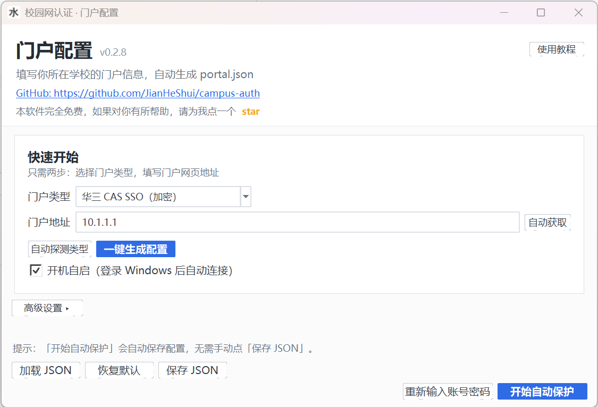

# 校园网自动登录工具

一个 Windows 校园网自动认证工具：**配置一次，后台守护、断线自动重连**，无需每次手动打开认证页。

- 🚀 接口直连，不驱动浏览器，快、稳、省资源
- 🖥️ 可视化中文配置界面，任何学校的门户都能填
- 📌 系统托盘常驻，实时显示「保护中 / 未保护」与开机自启状态
- 🔁 断线自动重连：默认 60 秒复核 + Windows 网络变化即时触发，失败自动退避重试
- 🎛️ **三种认证模式**：锐捷 SAM+ 工作流 / 华三 CAS SSO / 通用登录
- 🔍 门户类型自动探测；应用模板会**自动校验类型**
- 🛡️ 认证日志自动脱敏（不落账号密码等敏感信息）

---

## 下载与安装

到 [Releases](https://github.com/JianHeShui/campus-auth/releases) 页面下载最新版（无需安装 Python），任选一种：

| 版本 | 用法 |
|---|---|
| **`campus-auth-v0.4.0.zip`**（推荐） | 解压到任意文件夹 → 双击 `campus-auth.exe` 运行；启动快、杀软误报少 |
| `campus-auth-v0.4.0-单文件版.exe` | 单个 exe，双击即用、免解压；首次启动稍慢（需自解压），若杀软拦截请添加信任 |

> 首次运行会在桌面自动创建「校园网自动登录」快捷方式，并弹出配置界面 + 启动托盘。
> 建议先看一遍「使用教程」（配置界面右上角会自动弹出）。

## 快速开始（三步）

| 步骤 | 操作 |
|---|---|
| ① 打开配置 | 双击 `campus-auth.exe`，自动弹出配置界面（托盘也在右下角） |
| ② 填门户信息 | 输入门户地址（或连上校园网但未认证时点「自动获取」）→ 点「应用模板」（会自动探测并校验门户类型） |
| ③ 开启自动保护 | 点「开启后台守护」→ 输入账号、密码、运营商 → 完成 |

之后程序进入**自动保护**：后台持续守护、断线自动重连，直到你在托盘菜单点「停止自动保护」
（**不是单次登录**）。**运行中点「重启后台守护」会应用新配置**。

## 详细说明

### 配置界面

「门户设置」区三步完成：**填门户地址 → 应用模板 → 开启后台守护**。

- **自动获取地址**：连上校园网但未认证时点「自动获取」，自动从网关劫持中提取认证页地址；支持 DNS 故障回退（直接探测公网 IP）与多种网关跳转写法
- **自动探测类型**：自动识别锐捷 SAM+ / 华三 CAS SSO / 深澜等厂商
- **应用模板自动校验**：生成后自动探测一次真实门户类型；若与你选择的类型不一致，会弹窗提醒并询问是否改用探测结果重新生成

界面采用中性灰配色、垂直排版，底部按钮固定大小，输入框支持右键复制/粘贴。
需要改接口路径、字段名等细节时，点「高级设置」展开完整表单。



### 支持的认证模式

| 模式 | 适用 |
|---|---|
| 锐捷 SAM+ 工作流 | 锐捷认证门户 |
| 华三 CAS SSO（AES 加密） | 华三 CAS + 锐捷工作流混合门户 |
| 通用登录 | 其他门户兜底 |

### 自动保护、单次登录与开机自启的区别

| 方式 | 行为 | 入口 |
|---|---|---|
| **自动保护**（推荐） | 后台独立进程**持续运行**：断线自动重连（默认 60 秒复核 + 网络变化即时触发）；关闭配置窗口不影响，直到手动停止 | 配置界面「开启后台守护」/ 托盘菜单「开启自动保护」 |
| **单次登录** | 只认证一次、不常驻（认证完就退出） | 命令行 `campus-auth login`（图形界面不提供） |
| **开机自启** | 开机登录 Windows 后自动以托盘运行，并**一直常驻**、自动保护 | 配置界面勾选「开机自启」 |

> 托盘悬浮提示与右键菜单会同时显示当前「保护中 / 未保护」和「开机自启：已开启 / 未开启」，
> 可以随时确认是否处于持续保护、以及电脑重启后是否会自动运行。

### 系统托盘

运行后右下角出现「水」字图标：

- **状态显示**：鼠标悬停悬浮提示显示「保护中 / 未保护」与「开机自启：已开启 / 未开启」；
  右键菜单前两行也显示这两项状态
- **右键菜单**：状态 / 开机自启状态 / 配置 / 开启自动保护（保护中显示「重启自动保护」）/
  停止自动保护 / 退出
- **退出**：停止自动保护，并**关闭正在打开的配置界面窗口**（窗口会先自动保存配置再关闭）
- **双击**：打开配置界面

**自动保护是持续运行的**：由独立后台进程执行，关闭配置窗口或托盘不影响它，断线会自动重连；
只有点「停止自动保护」或「退出」才会停止（不是单次登录）。

### 断线检测与重连

自动保护会持续检测网络状态并自动重连：

- **在线复核**：默认每 **60 秒**复核一次（掉线后最坏约 1 分钟发现并重连）；
- **网络变化即时触发**：网卡断开/重连、切换 Wi-Fi、DHCP 换址时立即复核（约 2 秒防抖，等网络就绪）；
- **失败退避**：认证失败按 60/120/240/300 秒退避重试，恢复后回到 60 秒复核。

如想更灵敏（或更省流量），可在配置界面「高级设置 → 自动保护」调整「在线复核间隔」与
「失败重试上限」（5–3600 秒）；也可以直接改 `portal.json` 的 `watch` 段。
网络变化监听不可用时程序会自动退化为普通轮询，不影响认证。

### 开机自启

配置界面里勾选「开机自启」后，开机登录 Windows 会自动以托盘运行并**开启自动保护**，之后一直常驻；
托盘菜单与配置界面都会显示「开机自启：已开启」。取消勾选后，程序只在本次手动运行时保护，
电脑重启后不再自动运行。

### 运营商

认证时选择运营商（中国移动/联通/电信/校园网），程序会自动映射到对应的服务名（如联通→unicom）。

### 日志与凭据

- 账号密码保存在本机 `~/.campus-auth/credentials.json`（明文保存，请勿上传或分享）
- 认证调试日志位于 `~/.campus-auth/auth-debug.log`：账号、密码密文、密钥、会话 token 等均自动脱敏；超过 2MB 自动轮转

## 常见问题

**Q：怎么知道现在是否处于保护状态、是否开机常驻？**
鼠标悬停托盘图标，悬浮提示会显示「保护中 / 未保护」与「开机自启：已开启 / 未开启」；
右键菜单前两行也有这两项状态。

**Q：改了配置怎么让新配置生效？**
保护中点击配置界面底部「重启后台守护」（或托盘菜单「重启自动保护」），程序会自动停止并重启保护，新配置立即生效。

**Q：连了别的网络（家里 WiFi / 手机热点），程序会误操作吗？**
不会。程序只对你配置的校园网门户进行认证，其他网络下静默待命。

**Q：为什么托盘图标在右下角看不到？**
Windows 11 会把新托盘图标折叠到「^」箭头里，点一下展开即可。

**Q：能上网了，但 Windows 任务栏显示「无 Internet」？**
认证成功后程序会自动刷新 DNS 缓存并触发 Windows 网络状态检测，通常几秒内恢复「已连接」。若仍不刷新，是 Windows NCSI 判定延迟，不影响实际联网。

**Q：点「开启后台守护」后关闭窗口，还会继续认证吗？**
会。自动保护由独立后台进程持续运行，关闭配置窗口不影响；想停止时在托盘右键菜单点「停止自动保护」即可。

**Q：点「开启后台守护」是只登录一次吗？**
不是。它是**自动保护**：后台持续运行、断线自动重连，直到你手动停止；不是单次登录。
只登录一次请用命令行：`campus-auth login`。

**Q：怎样让它开机后一直运行？**
配置界面勾选「开机自启」后，开机登录 Windows 会自动以托盘运行并开启自动保护；
托盘菜单显示「开机自启：已开启 / 未开启」。不想开机运行时取消勾选即可。

**Q：掉线后多久会自动重连？**
通常 1 分钟内：默认每 60 秒复核一次；如果网卡断开/重连、切换 Wi-Fi 或 DHCP 换址，
程序会收到 Windows 网络变化通知并立即复核（约 2 秒防抖后）。
想更灵敏可在「高级设置 → 自动保护」把「在线复核间隔」调到 15–30 秒。

**Q：账号密码存在哪里？**
存在本机 `~/.campus-auth/credentials.json`。请不要把该文件上传到公开仓库。

**Q：换学校了怎么办？**
重新打开配置界面，改门户地址 + 应用模板 + 开启后台守护即可。

## 免责声明

本软件完全免费，仅供学习交流，用于自动完成**本人账号在所在校园网**的认证。请遵守所在学校网络使用规定；使用产生的一切后果由使用者自行承担。

如果对你有所帮助，请给我点一个 ⭐ star

## 许可证

[MIT](LICENSE)

---

## 开发者

### 从源码运行

要求 Windows + Python 3.10+：

```powershell
cd campus-auth
python -m campus_auth config   # 配置界面
python -m campus_auth tray     # 托盘（自动保护常驻）
python -m campus_auth watch    # 自动保护守护循环（持续运行，需手动停止）
python -m campus_auth login    # 单次登录（认证一次就退出）
```

> 华三 CAS SSO 模式依赖 `pycryptodome`（AES 密码加密）；锐捷/通用模式为纯标准库。
> 从源码运行 CAS 模式时先安装：`python -m pip install pycryptodome`（或 `pip install -e ".[cas]"`）。
> 打包时已内置依赖，最终用户无需安装。

### 打包 exe

```powershell
powershell -ExecutionPolicy Bypass -File .\build.ps1
# 产物：dist\campus-auth\ 目录 + dist\campus-auth-v<版本>.zip 发布包（推荐的发布形式）
```

> `build.ps1` 会自动安装 `requirements-build.txt` 中钉死版本的依赖，并产出目录版、
> 发布 zip（内含 LICENSE/README/示例配置）、单文件版与 `SHA256SUMS.txt`；
> 已有构建环境时可加 `-SkipDeps`。单文件版首次启动需自解压，更容易被部分杀软误报。

### 测试

```powershell
python -m unittest discover -s tests -v
# 217 项测试，全部不触网；CI 配置见 .github/workflows/tests.yml（Windows + Python 3.10/3.12）
```

本项目为对门户进行**黑盒探测后的独立实现**，未参考第三方登录工具源码，声明见 [docs/portal-profile.md](docs/portal-profile.md)。
